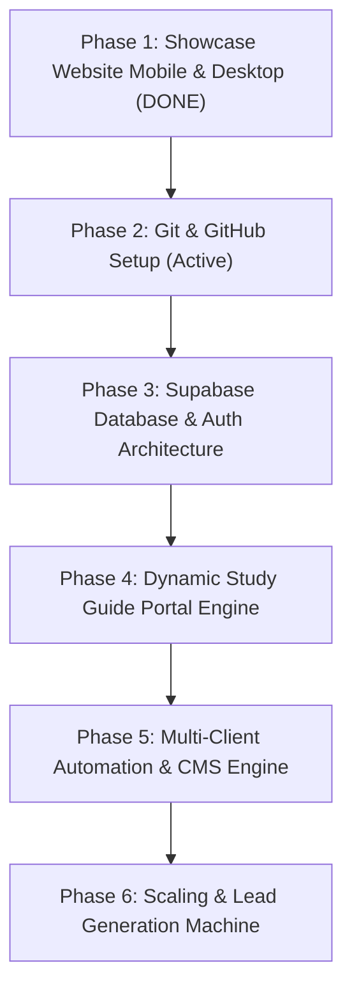

# TRIVIAL CODE — MASTER BUSINESS BLUEPRINT & AI CONTINUITY SYSTEM

> **IMPORTANT TO ALL FUTURE AI AGENTS / CODING ASSISTANTS:**
> This document is the single source of truth for **Trivial Code**. Whenever you begin or complete work on this project, you **MUST**:
> 1. Read this entire document before writing any code or architecture.
> 2. Respect the privacy, aesthetic guidelines, and business goals outlined here.
> 3. Update the **"Active Project State & AI Work Log"** at the bottom of this file before finishing your session so the next AI knows exactly what is done and what comes next.

---

## 1. Company & Business Overview

### 1.1 Brand Identity
- **Business Name:** Trivial Code
- **Tagline:** *"Code Made Easy / Going Live Even Easier"* | *"Code With a Little More Intention Behind It."*
- **Aesthetic:** Dark Luxury / Editorial / Moody Forest Green, Warm Cream accents (`#f5f0ea`), Muted Gold (`#c5a880`), clean typography pairing (*Playfair Display* serif with *Plus Jakarta Sans*).
- **Public Founder Identity:** **Production Team** (all founder references remain anonymous).
- **Public Contact:**
  - **Email:** `trivialcodes@gmail.com`
  - **Phone:** `718-924-0868`
  - **Instagram:** `@trivialcode` (https://www.instagram.com/trivialcode/)
  - **LinkedIn:** https://www.linkedin.com/in/trivial-code-986622442/
- **Accepted Payments:** Zelle, Cash App, Venmo.

### 1.2 Core Business Model & Revenue Streams
1. **Interactive Study Guides (Flagship EdTech Product):**
   - High-value, passcode-protected, expiring study guides for educators, tutors, and course creators.
   - Solves the problem of intellectual property theft: educators want students to study interactively without being able to steal, print, or share the source content indefinitely.
   - Features: Passcode portal, expiration date locking, interactive flashcards/quizzes, no source code access given to clients.
2. **Custom Websites:**
   - Bespoke, high-converting digital storefronts and portfolios for thoughtful founders and independent brands.
3. **Custom Mobile Apps:**
   - Clean cross-platform iOS & Android apps built for quick deployment to the App Store without overcomplicated tech.
4. **Monthly Retainer / Maintenance Subscription:**
   - Recurring monthly fee for client site uptime, updates, instant bug fixes, and continuous performance tuning.
   - Subscriber bonus: Active subscribers receive discounts on any subsequent new project builds.
5. **Coding Masterclass:**
   - Classes teaching practical, modern coding workflows for quick payouts. Empowering students to build client products and generate income without high initial overhead.

---

## 2. Technical Stack & Integrated Ecosystem

To run this business smoothly across **multiple clients**, **multiple study guides**, and **apps/websites**, we use a unified, scalable ecosystem:

| Layer | Tool | Purpose | Status |
| :--- | :--- | :--- | :--- |
| **Frontend Showcase** | Vanilla HTML5, CSS3, ES6 JS, Lucide Icons | Main marketing website (`index.html`, `style.css`) | **Phase 1 Live & Optimized** |
| **Version Control & CI/CD** | **GitHub** | Code repo, multi-branch deployments, automated backups | Pending Setup |
| **Hosting & Edge Deployments** | **Vercel** / **Cloudflare Pages** | Zero-downtime, global CDN hosting with custom domain | Pending Setup |
| **Backend & Database** | **Supabase** (PostgreSQL) | Client management, study guide access keys, passcodes, expiration timestamps, analytics | Pending Setup |
| **Client Portal / Study Engine** | HTML5 / Vite or Next.js + Supabase Auth | Dynamic study guide delivery engine with expiration enforcement | Pending Setup |
| **Email & Lead Handling** | Resend / Formspree / Supabase Edge Functions | Lead contact form notifications to `trivialcodes@gmail.com` | Pending Setup |

---

## 3. Study Guide System Architecture (Detailed)

### How It Works for Clients & Students:
1. **Creation:** A new study guide is created with content (flashcards, quiz questions, study modules).
2. **Access Control:** A unique slug or access link is generated (e.g. `trivialcode.co/guide/anatomy-101` or `study.trivialcode.co/bio`).
3. **Student Login:** Student enters a unique or cohort passcode.
4. **Expiration Enforcement:** Supabase checks:
   - Is `current_timestamp < expiration_date`?
   - If YES: Unlock study content.
   - If NO: Display a custom expired screen (*"This study session has ended. Contact your instructor for renewed access."*).
5. **IP Protection:** Right-click disabled, print stylesheets disabled, content fetched dynamically in memory so students cannot easily scrape the raw content.

---

## 4. Secure Credentials & Access Vault

> ⚠️ **SECURITY PROTOCOL FOR ALL AI AGENTS:**
> Store references and environment variable keys here. **Never expose raw database secret service keys or unencrypted passwords directly in public GitHub repositories.** Always use `.env.local` files and environment variable secrets in hosting providers (Vercel/Cloudflare/Supabase).

| Platform / Service | Identifier / Email | Purpose | Key / Secret Location |
| :--- | :--- | :--- | :--- |
| **GitHub** | `trivialcodes@gmail.com` | Repository hosting & organization | Git credentials / SSH key |
| **Supabase** | `trivialcodes@gmail.com` | Database, auth, expiring token tables | Project URL & Anon/Service Role Keys in `.env` |
| **Vercel / Cloudflare** | `trivialcodes@gmail.com` | Production website hosting & DNS | Linked to GitHub repo |
| **Gmail** | `trivialcodes@gmail.com` | Inquiries & notifications | App Password / OAuth |
| **Instagram** | `@trivialcode` | Marketing & client acquisition | Managed on device |
| **LinkedIn** | `Trivial Code` | B2B networking | Managed on device |
| **Payment Handles** | Zelle / Cash App / Venmo | Client billing | Listed in website Services section |

*(Future AI: When the user provides new API tokens or URLs, document their variable names and locations above).*

---

## 5. Step-by-Step Implementation Roadmap

### Phase 1: Showcase Website Layout & Polish (COMPLETED)
- Desktop version fully built and verified with embedded demo videos.
- Mobile Hero Section perfectly positioned above background laptop photo.
- Mobile About Me section streamlined with contact handles directly under the headline.
- Mobile full-screen slide navigation with animated hamburger button.

### Phase 2: Git & GitHub Foundation (COMPLETED)
- Initialized local Git repository in project directory with `main` branch.
- Configured `.gitignore` for security and clean tracking.
- Set author identity anonymously to `Production Team <trivialcodes@gmail.com>`.
- Connected and synchronized with official GitHub remote: `https://github.com/trivialcodes/Trivial-code`.

### Phase 3: Supabase Backend Setup (COMPLETED)
- Created Supabase project `trivial-code-core` (Project ref: `fumwppanjyrccbtoxdli`, Region: `us-east-1`).
- Saved credentials to local git-ignored `.env.local` vault.
- Designed and executed `supabase_schema.sql` database schema:
  - `clients` table
  - `study_guides` table with passcode & expiration timestamp
  - `study_modules` table with JSONB interactive content
  - `contact_leads` table with public submission RLS
  - Secure PostgreSQL RPC `access_study_guide` for passcode verification and automated expiration enforcement.

### Phase 4: Study Guide Product Engine (ACTIVE)
1. Build reusable frontend study guide portal (`study.html`) with passcode entry screen.
2. Hook passcode input to Supabase client / `access_study_guide` RPC.
3. Deliver interactive study experience (clean mobile-first flashcards, multiple-choice quizzes, progress counters).
4. Enforce expiration screen when date has passed.
5. Seed demo study guide for portfolio showcase and client demos.

### Phase 5: Multi-Client Workflow System
1. Standardize client onboarding templates for:
   - Websites (Starter, Pro, Enterprise).
   - Study Guides (Standard, Multi-cohort, Custom Branding).
   - Subscriptions (Monthly maintenance, bug fixes, performance monitoring).
2. Automated invoice and payment instructions (Zelle, Cash App, Venmo).

---

## 6. Active Project State & AI Work Log

> 📌 **AI INSTRUCTION:** Whenever you complete tasks or make changes, append an entry below with the date, changes made, and explicit next steps.

### Entry: 2026-10-10 (Phase 2 & Phase 3 COMPLETED -> Phase 4 Initiated)
- **Current State:**
  - **Phase 1**: Main website layout and mobile polish completed.
  - **Phase 2**: GitHub repository initialized, anonymous identity configured, and pushed (`https://github.com/trivialcodes/Trivial-code`).
  - **Phase 3**: Supabase project `trivial-code-core` provisioned, credentials saved, and `supabase_schema.sql` successfully executed with full table suite and secure `access_study_guide` RPC.
  - **Phase 4**: In progress. Building the passcode-protected, auto-expiring Study Guide engine (`study.html`).
- **Immediate Next Task for Next AI:**
  1. Retrieve Supabase public anon key from Project Settings -> API.
  2. Implement `study.html` featuring passcode validation, countdown indicator, interactive flashcard carousel, and quiz modes.
  3. Insert sample study guide to test real database verification and expiration enforcement.
