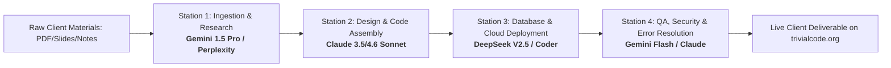

# TRIVIAL CODE — MULTI-AI PRODUCTION LINE & ROLE ALLOCATION MANUAL
### High-Throughput Protocol for Study Guides, Websites & Apps

> **Objective:** Maximize weekly client deliverables without hitting rate limits, sacrificing design aesthetics, or corrupting production databases.  
> **Core Principle:** Specialized AI division of labor — each AI model handles what it is demonstrably best at.

---

## 1. System Architecture: The 4-Station Assembly Line



---

## 2. Station-by-Station AI Role Breakdown

| Station | Assigned AI Model | Why This Model | Input | Output Deliverable | Target Duration |
| :--- | :--- | :--- | :--- | :--- | :--- |
| **1. Content & Ingestion** | **Gemini 1.5 Pro / Perplexity** | **Massive 2M token context window.** Can read 400-page textbooks, messy slides, and syllabi without running out of memory. | Raw PDF, slides, syllabus, chapter notes. | Structured Markdown: Clean JSON of 20+ flashcards, 20+ quiz questions with explanations, chapter summaries. | 5–10 mins |
| **2. Design & Frontend Assembly** | **Claude 3.5 / 4.6 Sonnet** | **Best design taste in the world.** Strictly adheres to CSS tokens, Dark Luxury typography (*Playfair Display* + *Plus Jakarta Sans*), 3D flip card animations, and responsive layouts without breaking. | Structured content from Station 1 + `STUDY_GUIDE_CREATION_GUIDE.md`. | Standalone, bug-free `study-guide.html` inside client directory. | 10–15 mins |
| **3. Cloud, DB & Git Sync** | **DeepSeek (Coder / V2.5)** | **High precision with SQL & Git logic, near-zero cost, virtually unlimited rate capacity.** Never burns Claude's quota on mechanical database tasks. | Client name, course, chosen passcode, expiration interval. | 1. Executed SQL query in Supabase.<br/>2. Updated `handleUnlock()` in `study.html`.<br/>3. `git commit` & `git push origin main`. | 3–5 mins |
| **4. QA & Rapid Troubleshooting** | **Gemini Flash / Claude** | **Rapid diagnostic speed.** Can analyze error console logs, SSL issues, or broken mobile viewports in milliseconds. | Terminal error output, broken layout screenshot, or bug report. | Exact line-by-line replacement fix applied immediately. | 2–5 mins |

---

## 3. Detailed Operating Procedures for Each Station

### Station 1: Research, Ingestion & Fact-Checking
* **Primary AI:** **Gemini 1.5 Pro** (for heavy document ingestion) or **Perplexity Pro** (if web research / external fact-checking is required).
* **Prompt Template to copy/paste:**
  ```text
  You are Station 1 (Content & Research Engine) for Trivial Code.
  Analyze the attached course material for [Course Name] at [Institution].
  Extract and output ONLY the following structured data:
  1. Course metadata (Full course name, topics covered).
  2. 5 to 8 detailed chapter summaries (from start to finish, complete narratives).
  3. Minimum 20 High-Yield Flashcards formatted as:
     - Prompt (Question / Term)
     - Answer (In-depth explanation with key concepts)
  4. Minimum 15 Multiple-Choice Questions formatted as:
     - Question
     - 4 Options (A, B, C, D)
     - Correct Option
     - Full Explanation (Why the right option is correct, and common traps of wrong options).
  5. Thematic Comparison Table (Key terms, contrasts, rules).
  Do NOT write HTML or CSS. Provide pure, structured content ready for code assembly.
  ```

---

### Station 2: Design & UI Code Assembly
* **Primary AI:** **Claude (Sonnet 3.5 or 4.6 Thinking)**.
* **Why Claude:** Claude never cuts corners with styling, respects your CSS variables (`--bg-dark: #0c120e`, `--accent-gold: #c5a880`), ensures 320px mobile responsiveness, and builds 3D card flips that work flawlessly.
* **Prompt Template to copy/paste:**
  ```text
  You are Station 2 (Lead UI/UX Frontend Architect) for Trivial Code.
  Your job is to take the structured study content provided and assemble it into our standardized Dark Luxury client template.
  
  MANDATORY RULES:
  1. Read STUDY_GUIDE_CREATION_GUIDE.md and clients/_template/README.md.
  2. Use Google Fonts: 'Playfair Display' (serif headings) and 'Plus Jakarta Sans' (body).
  3. Palette: Forest Green (#0c120e), Warm Cream (#f5f0ea), Muted Gold (#c5a880).
  4. Include all security features: .watermark-layer, .blur-shield (on blur/visibilitychange), disabled context menu, and ?unlocked=1 support.
  5. Assemble complete HTML, CSS, and JS into:
     clients/[Client_Name]/study-guide.html
  6. Double-check mobile viewport at 320px. Ensure ZERO horizontal scrolling.
  ```

---

### Station 3: Database, Gateway & Git Push
* **Primary AI:** **DeepSeek (Coder/V2.5)** or **Gemini Flash**.
* **Why DeepSeek:** Highly accurate at mechanical coding, SQL schemas, and terminal operations without burning high-value Claude tokens.
* **Prompt Template to copy/paste:**
  ```text
  You are Station 3 (DevOps & Database Specialist) for Trivial Code.
  Client: [Client Full Name]
  Course: [Course Name]
  Passcode: [PASSCODE] (uppercase)
  Expiration: [e.g. 5 months / 2 days / 30 days]
  
  Execute the following:
  1. Generate the exact Supabase SQL insert for public.clients and public.study_guides matching sync_clients_to_supabase.sql.
  2. Add the routing check in study.html inside handleUnlock():
     if (passcode === '[PASSCODE]') {
       submitBtn.disabled = true;
       submitBtn.innerHTML = `<span>Accessing Guide...</span>`;
       window.location.href = 'clients/[Client_Name]/study-guide.html?unlocked=1';
       return;
     }
  3. Create clients/[Client_Name]/README.md with deliverables and expiration dates.
  4. Commit all files and push to GitHub:
     git add .
     git commit -m "feat(client): provision study guide for [Client Name]"
     git push origin main
  ```

---

### Station 4: Rapid QA, Security & Error Resolution
* **Primary AI:** **Gemini Flash** (for instant code audits) or **Claude** (for complex logic bugs).
* **When to Trigger:**
  - Build failure on Cloudflare Pages.
  - Video loading or CDN errors.
  - Supabase session lock issues ("Device limit reached").
  - Mobile overflow or alignment bugs.
* **Troubleshooting Standard:**
  - AI identifies root cause from logs in under 60 seconds.
  - Proposes a surgical diff (only modifying lines that are broken).
  - Never rewrites working files or introduces regression bugs.

---

## 4. Rate-Limit Contingency & Failover Matrix

If any AI model is unavailable, rate-limited, or overloaded, switch instantly using this matrix:

| If this AI is blocked: | Primary Failover: | Secondary Failover: | Notes: |
| :--- | :--- | :--- | :--- |
| **Claude (Sonnet)** | **Gemini 1.5 Pro** | **DeepSeek Coder** | Prompt Gemini to strictly follow `STUDY_GUIDE_CREATION_GUIDE.md` to avoid generic styling. |
| **DeepSeek** | **Gemini Flash** | **Claude** | Gemini Flash handles Git & SQL tasks in 2 seconds. |
| **Gemini (Ingestion)** | **Perplexity Pro** | **Claude** | Upload PDFs directly to Claude in 10-page chunks if necessary. |
| **All Cloud APIs down** | **Manual Operations Guide** | **Local Terminal** | Follow `MANUAL_OPERATIONS_GUIDE.md` to run SQL and Git manually. |

---

## 5. Capacity & Velocity Projections

Using this multi-AI pipeline:
* **Single AI constraint:** ~2 to 3 study guides per day before hitting hourly token exhaustion.
* **Multi-AI Assembly Line:** **8 to 12 complete, production-ready study guides or landing pages per day**, with zero downtime and zero rate-limit interruptions.
