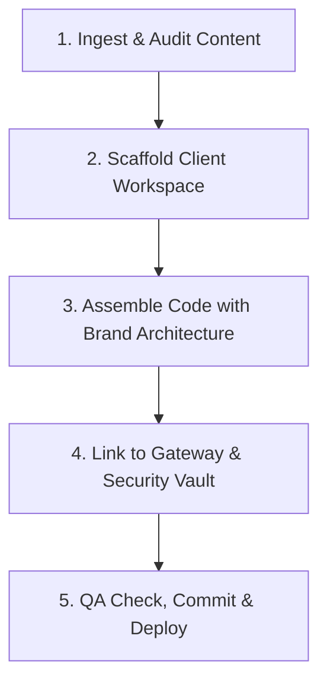

# TRIVIAL CODE — PRODUCTION ORDER OF OPERATIONS MANUAL
### Standard Operating Procedure (SOP) for Websites, Mobile Apps & Study Guides

> **CORE DIRECTIVE:**  
> It is IMPERATIVE that all client deliverables and internal systems are produced in a **rapid, precise, and uncompromising manner with ZERO mistakes**.  
> Every deliverable represents the Trivial Code standard: **Dark Luxury aesthetics**, flawless typography, complete responsiveness, ironclad security, and immediate client satisfaction.

---

## 1. Study Guide Production Pipeline (Minimal Time, Maximum Precision)

Follow this 5-stage order of operations whenever producing a study guide from raw client inputs (syllabi, slides, notes, textbook chapters):



### Stage 1: Ingest & Content Structure (Target: 10 mins)
1. Read all provided materials (slides, PDFs, notes).
2. Extract:
   - Reading list & authors.
   - Core chapter/module narrative summaries.
   - Minimum 15–20 high-yield flashcard questions and deep explanations.
   - Minimum 15–20 multiple-choice quiz questions with rationale for the right answer and pitfalls of wrong options.
   - Synthesized thematic comparison tables (e.g., Metamorphosis, Wrath of Gods, Rebellious Figures).

### Stage 2: Scaffold Client Directory (Target: 2 mins)
1. Create a dedicated folder: `clients/client_<clientname>/`.
2. Populate the client `README.md` with:
   - Client full name & university/course.
   - Chosen uppercase passcode (e.g. `CLST036`).
   - Hard expiration date (e.g., end of current semester).

### Stage 3: Assemble Code & Brand Architecture (Target: 15 mins)
1. Verify the design tokens adhere strictly to the Trivial Code standard:
   - Palette: Forest Green background (`#0c120e` / `#111a14`), Warm Cream (`#f5f0ea` / `#e8e4dc`), Muted Gold (`#c5a880`), accents (`#1a8a78`, `#5548a8`).
   - Fonts: *Playfair Display* (headings), *DM Sans* / *Plus Jakarta Sans* (body), *DM Mono* (data badges).
2. Ensure interactive elements are fully functioning:
   - Accordion term cards (`.term-card.open`).
   - 3D perspective flip flashcards with counter and navigation.
   - Interactive quiz with instant visual feedback and score calculation.
   - SVG animated progress ring.
   - Mobile collapsible sidebar navigation.
3. Apply security mechanisms:
   - Context menu & print keystroke interception.
   - Anti-screenshot blur shield on window blur/tab switch.
   - Translucent diagonal watermark overlay stamped with session/timestamp.
   - URL bypass query parameter support (`?unlocked=1`).

### Stage 4: Gateway & Supabase Integration (Target: 5 mins)
1. In `study.html`, add the passcode routing entry inside `handleUnlock()`:
   ```javascript
   if (cleanCode === 'YOURCODE') {
       showToast('Passcode verified. Opening Guide...', 'success');
       setTimeout(() => { window.location.href = 'study-yourcode.html?unlocked=1'; }, 600);
       return;
   }
   ```
2. Generate and run the SQL insert in Supabase (`public.clients` and `public.study_guides`).

### Stage 5: Zero-Defect QA & Push (Target: 3 mins)
1. Test desktop layout and mobile viewport (320px & 375px).
2. Verify quiz calculations and card flipping.
3. Commit to GitHub:
   ```bash
   git add .
   git commit -m "feat(guide): release [Course] study guide for client [Name]"
   git push origin main
   ```

---

## 2. Custom Website Order of Operations

For bespoke client web builds:

1. **Discovery & Asset Intake:** Extract client brand colors, target audience, preferred copy, and offerings.
2. **Design System Initialization:** Define CSS tokens in `:root` (backgrounds, surfaces, typography, shadows, borders).
3. **Semantic Hierarchy:** Assemble single `h1`, responsive grid layouts, mobile navigation drawer, and contact forms.
4. **Motion & Interaction:** Add micro-animations (card hover elevation, smooth scrolling, button focus rings).
5. **SEO & Performance:** Insert metadata, OpenGraph tags, web font preloading, and optimize all assets.
6. **Form & Lead Hookup:** Connect forms to `trivialcodes@gmail.com` via Supabase Edge Function or Formspree.
7. **Client Delivery:** Store site under `clients/client_<name>/website/` and deploy to live preview.

---

## 3. Mobile App Order of Operations

For cross-platform client app requests:

1. **Feature Specification:** Define core screens (Auth, Feed/Dashboard, Detail view, Settings).
2. **Design Tokens & Theme:** Match brand typography and Dark Luxury or client color palette.
3. **Data Schema & Supabase Setup:** Configure Postgres tables with Row Level Security (RLS).
4. **Component Construction:** Build reusable cards, tab navigation, and touch-optimized action buttons.
5. **State Management & Offline Capability:** Implement caching and token storage.
6. **Device Testing:** Test iOS & Android viewports, dark mode switching, and push notification hooks.
7. **Archival:** Store repository under `clients/client_<name>/mobile-app/`.

---

## 4. Cardinal Rules for AI & Human Operators

1. **No Broken Mobile Layouts:** Every page must work on a 320px screen without horizontal scroll overflow.
2. **Founder Anonymity:** Public attributions must ALWAYS be signed **Production Team**. Never leak personal founder identity.
3. **Code Review on External Snippets:** Whenever external code is supplied, audit it thoroughly for identifier clashes (e.g. `let supabase` global collisions), syntax errors, and missing security safeguards before deployment.
4. **Log Continuity:** Update Section 6 of `BUSINESS_PLAN_AND_AI_SYSTEM.md` at the conclusion of every milestone.
